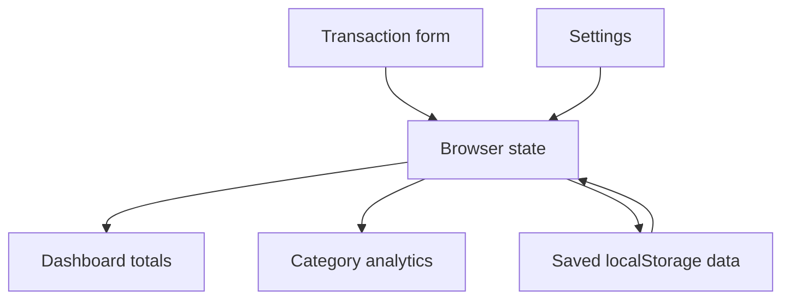

# FinTrack

**A straightforward expense tracker with a budget, category breakdowns, and browser-local storage.**


FinTrack is the single-page application in the `simple-expense-tracker` repository. Add everyday transactions, see how much of a budget remains, and review spending across five categories.

## Features

| Area | Behavior |
| --- | --- |
| Dashboard | Add and delete transactions; show total spending, remaining budget, and transaction count |
| Categories | Food, Transport, Study, Entertainment, and Other |
| Analytics | Category totals, spending proportions, top category, and budget usage |
| Settings | Change the displayed name and budget |
| Data management | Save in localStorage or reset transactions and settings after confirmation |

Amounts are displayed with a dollar symbol. The current application has no currency conversion, bank connection, account system, or cloud synchronization.

## Run

The simplest route uses Python 3:

```sh
git clone https://github.com/adeelfalaksher900-creator/simple-expense-tracker.git
cd simple-expense-tracker
python3 -m http.server 3000
```

Open **http://localhost:3000**.

The repository also includes Vite development scripts:

```sh
npm install
npm run dev
```

The app itself is native HTML, CSS, and JavaScript in `index.html`. It does not call Gemini and does not require a Gemini API key.

## Data flow



Transactions use `student_expenses`; preferences use `student_config`. Data belongs to the current browser origin and can be lost when site data is cleared. Local storage is not encrypted. This version has no export or restore workflow.

## Build and deploy

```sh
npm run build
```

The build script copies `index.html` into `dist/` using Unix-style shell commands. Publish `dist/` to a static host, or publish the root `index.html` directly. Tailwind, Lucide, and the Inter font load from third-party CDNs.

## Check changes

No automated test script is configured. Review adding and deleting transactions, recalculated totals, category analytics, saved preferences after reload, and reset confirmation. Use test data: the current version inserts transaction names into HTML templates and has no hardened storage-import validation.

## Files

| File | Purpose |
| --- | --- |
| `index.html` | Complete interface, calculations, and storage logic |
| `package.json` | Optional development server and static build scripts |
| `metadata.json` | Project metadata |

## Contributions and license

Open a focused pull request describing the change and how it was checked. No license file is currently included.

